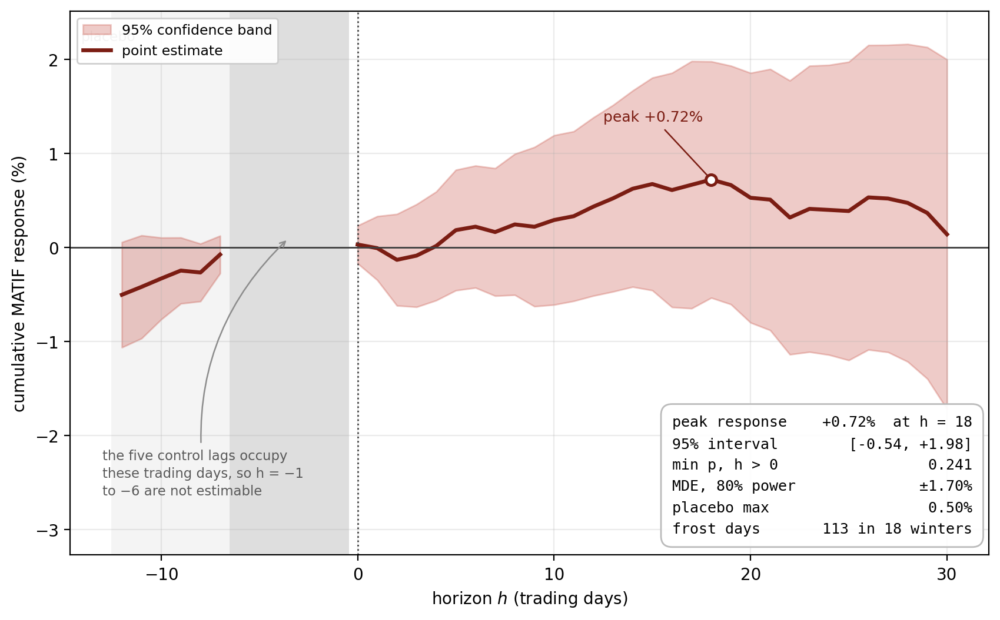
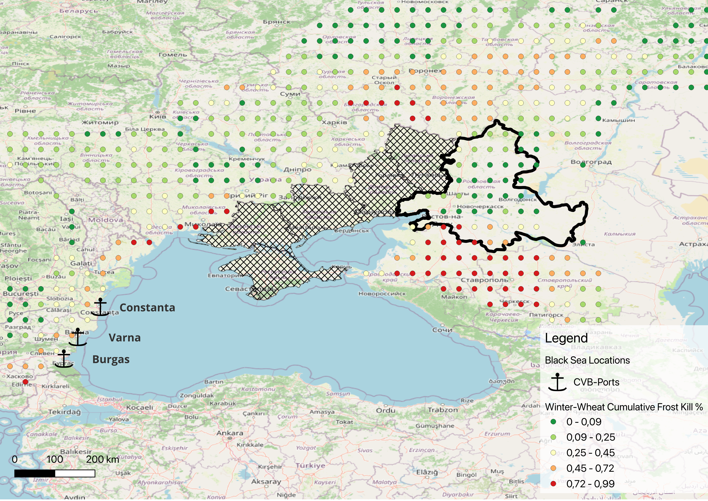

# A Frost-Kill Trading Signal for Black Sea Winter Wheat

BSc Honours research at Wageningen University & Research (2026), supervised by Prof. Joost Pennings.

This project turns a process-based crop model into a daily supply signal and tests whether it explains wheat futures returns. WOFOST with the FROSTOL winter-kill submodule simulates frost kill in Rostov Oblast, Russia's largest winter-wheat region. Each frost-kill day is then tested against Euronext milling wheat (MATIF) futures with local projections.

**Result.** The response peaks at +0.72% eighteen trading days after a frost-kill day (95% CI −0.54% to +1.98%). No horizon is significant (minimum p = 0.241) and the minimum detectable effect at 80% power is ±1.70%. The design bounds the effect rather than finding one. Coarse reanalysis weather, a snow model calibrated further north and the MATIF proxy all pull the estimate toward zero, so this null cannot separate an efficient market from an imprecise signal.

Paper: [Frost_Kill_Trading_Signal.pdf](Frost_Kill_Trading_Signal.pdf)



## Method

1. **Wheat grid.** CROPGRIDS wheat area (0.05°) is summed onto the 0.5° NASA POWER grid. A cell is kept when wheat covers at least 10% of its area, and each cell is labelled by oblast.
2. **Crop model.** WOFOST with FROSTOL (PCSE 6.0.12) runs daily in every Rostov wheat cell. FROSTOL uses the MOCCCASIN calibration for Russian winter wheat (LT50C = −18 °C, KILLCF = 1.0189). SnowMAUS supplies snow depth and NASA POWER (MERRA-2) supplies weather.
3. **Signal.** Daily kill is weighted by wheat area into one Rostov series. A day with new kill is a frost-kill day, coded as a binary shock.
4. **Prices.** Each frost winter is matched to the first Euronext contract delivering the damaged harvest, MLX06 to MLX14 before the 2015 delivery-cycle change and MLU15 to MLU26 after it. Returns are computed within contract, so no roll adjustment is needed. MATIF stands in for the thinly traded CME Black Sea Wheat (CVB) contract. Daily returns of the two correlate at r = 0.73 over 299 days.
5. **Econometrics.** Local projections (Jordà, 2005) of cumulative returns on the binary shock for h = −12 to 30, with five lagged returns as controls and Newey-West standard errors. Pre-event horizons serve as a placebo. An event study takes the peak-kill day of each crop year as one event.



## Repository layout

```
├── 01_signal_generation.ipynb     FROSTOL kill surface across the basin, 2024/25 and 2025/26
├── 02_oblast_daily_signal.ipynb   daily area-weighted kill per oblast, 2000/01 to 2025/26
├── 03_local_projection.ipynb      contract panel, local projections, event study, robustness
├── functions/
│   ├── fix_winterkill.py          runtime patches for PCSE 6.0.12
│   ├── power_snow.py              NASA POWER snow depth (prescribed-snow option)
│   ├── build_fetch_points.py      CROPGRIDS to a wheat-weighted 0.5° fetch grid
│   └── join_oblasts.py            country and oblast labels for the fetch grid
├── data/
│   ├── generic_medium.soil
│   ├── fetch_points_0.5deg_labeled.csv
│   └── futures_prices/            Barchart contract files, not included (see Data)
├── output/
│   ├── oblast_signal/             daily kill series, the Rostov one feeds 03
│   ├── figures/                   paper figures (fig1 to fig5) and robustness figures
│   └── tables/                    local projection and event study results
└── Frost_Kill_Trading_Signal.pdf
```

## Paper figures

<!-- Before pushing: add the notebook behind Figure 3, or delete that row. -->

| Paper | Content | Code |
|---|---|---|
| Table 1 | FROSTOL and SnowMAUS parameters | `01_signal_generation.ipynb` |
| Figure 1 | FROSTOL diagnostics for one Rostov cell, 2025/26 | `01_signal_generation.ipynb` |
| Figure 2 | Kill surface across the Black Sea wheat belt, 2025/26 | GeoJSON from `01_signal_generation.ipynb`, styled in QGIS |
| Figure 3 | CVB and MATIF (USD) prices, r = 0.73 | `04_cvb_matif_correlation.ipynb` |
| Figure 4 | Local projection up to 30 trading days | `03_local_projection.ipynb` |
| Figure 5 | Event study by crop year | `03_local_projection.ipynb` |

`03_local_projection.ipynb` also holds robustness checks that are not in the paper. They cover old-crop versus new-crop contracts, horizons up to 60 days, a spring subsample, a volatility response, a rank-graded shock and a severity ladder. None changes the conclusion. The spring event study comes closest, with 11 of 13 crop years positive at h = 20, but it does not hold at neighbouring horizons and the pooled spring local projection is near zero.

## Implementation notes

- **PCSE patch.** The `Wofost_winterkill` crop wrapper shipped with PCSE 6.0.x has fallen out of step with the current WOFOST 7.2 modules. `fix_winterkill.py` realigns it in memory. It also caps NASA POWER requests 30 days before today, because the feed lags and the API rejects recent end dates. And it widens the rainfall range check, so a single spurious extreme day no longer drops a whole cell. Import it once, before building any `Engine`.
- **Weekend frost.** Kill that falls on a weekend or holiday is rolled onto the next trading session. A plain merge on trading dates would have discarded 48% of the kill mass. The roll asserts that total kill is conserved.
- **Contract checks.** When a Barchart symbol lookup fails, the site serves the previous contract under the new name. Each file is checked against its expected date window and hashed to catch duplicates.
- **Weighting.** The kill function is nonlinear, so kill is computed per cell and then weighted by wheat area. Averaging the weather first would smooth away the cold extremes that drive kill. Daily weights are renormalised over the cells that report.

## Running it

Tested with Python 3.13 and PCSE 6.0.12.

```bash
conda create -n frostkill python=3.13
conda activate frostkill
pip install -r requirements.txt
jupyter lab
```

Run the notebooks in order from the repository root.

- `01_signal_generation.ipynb` loads `output/frostol_grid_power_snowmaus.csv` when it exists. Delete that file to rerun the grid, which takes 25 to 40 minutes on the first pass because it makes one NASA POWER request per cell.
- `02_oblast_daily_signal.ipynb` caches FROSTOL output per cell in `output/oblast_signal/cell_cache/` (not in the repository). A run from scratch simulates 26 winters in 122 cells.
- `03_local_projection.ipynb` needs the price files described below and runs in about a minute.

NASA POWER needs no API key, and PCSE caches each response.

## Data

| Data | Source | In this repo |
|---|---|---|
| Weather | NASA POWER daily point API (MERRA-2) | fetched at run time |
| Wheat area | CROPGRIDS v1.08 (Tang et al., 2024), [doi:10.6084/m9.figshare.22491997](https://doi.org/10.6084/m9.figshare.22491997) | derived fetch grid only |
| Crop parameters | WOFOST crop parameter repository, `Winter_wheat_101` | fetched by PCSE |
| Futures prices | Euronext milling wheat via Barchart, MLX06 to MLX14 and MLU15 to MLU26 | no |

Barchart's terms do not allow redistribution, so the price files are not included. To rerun the price side, download daily history for each contract from 1 October before harvest to 31 July of the harvest year. Save each file in `data/futures_prices/` with a name that starts with the contract symbol (for example `mlu26_....csv`) and keep Barchart's default columns. The notebook reads `Time`, `Latest`, `Volume` and `Open Int`, and checks every file against its expected window. The continuous nearby series for the old-crop comparison goes in `data/futures_prices/nearby/`.

## Limitations

- NASA POWER is a coarse grid-cell average. It can smooth a cold snap or move kill onto a neighbouring day.
- SnowMAUS snow density is calibrated in Tula Oblast and applied to Rostov.
- MATIF proxies CVB, which itself settles on Romanian and Bulgarian ports.
- CROPGRIDS reports all wheat, not winter wheat only.
- The signal has not yet been validated against realised Rostov yields.

## Acknowledgements

Supervised by Prof. Joost Pennings (WUR, Marketing and Consumer Behaviour). FROSTOL parameters for Russian winter wheat follow the MOCCCASIN calibration, as provided by Allard de Wit (Wageningen Environmental Research), author of PCSE and its FROSTOL implementation.

Code is released under the MIT License.
